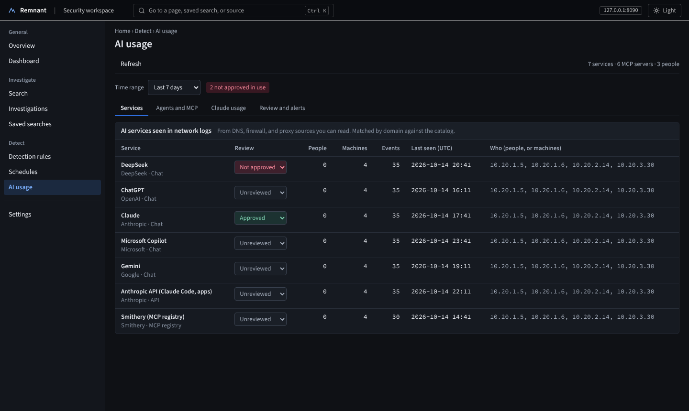
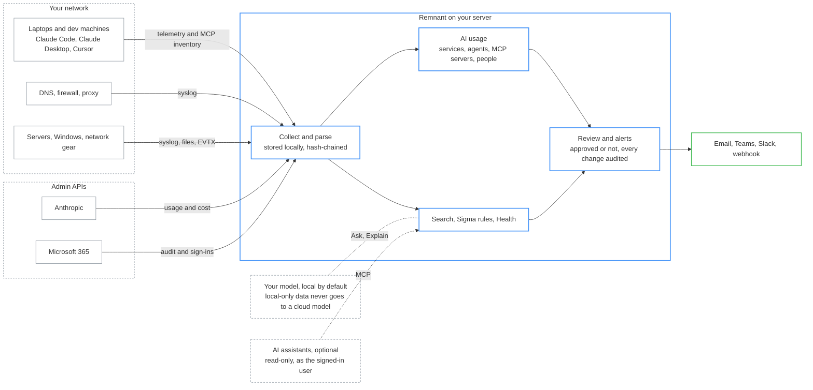
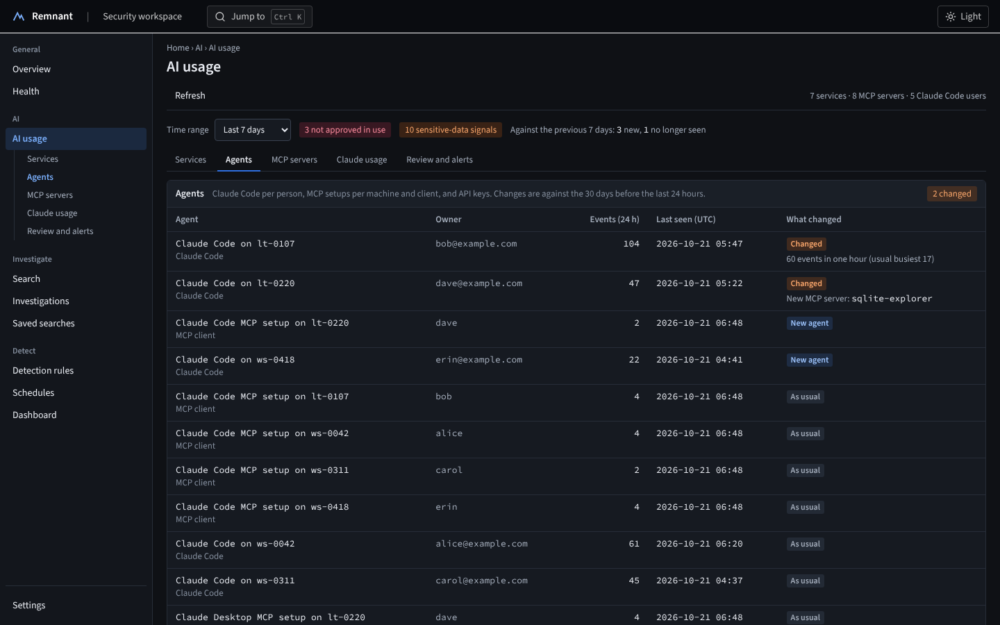
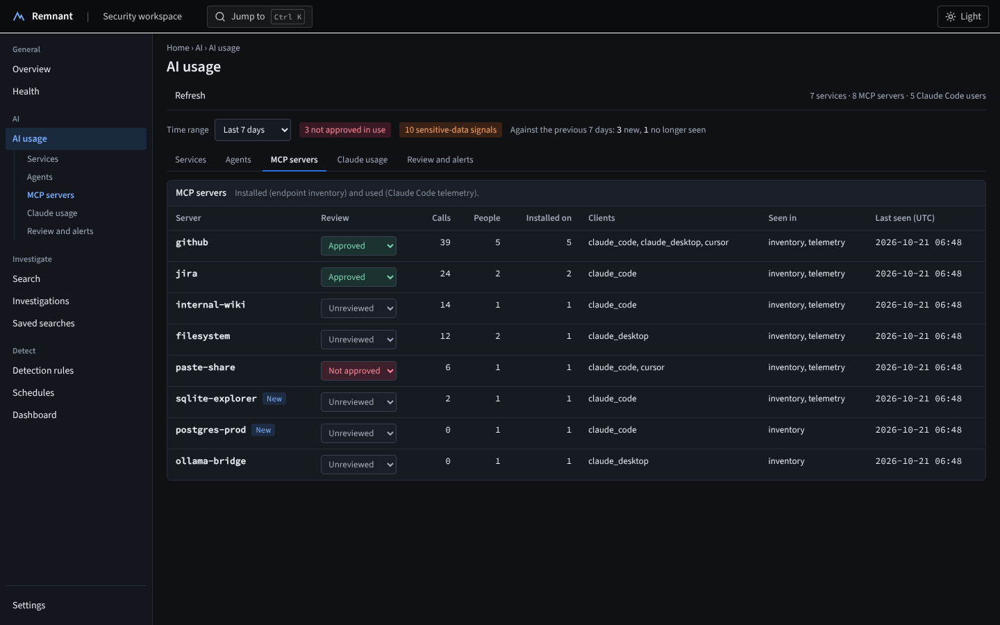
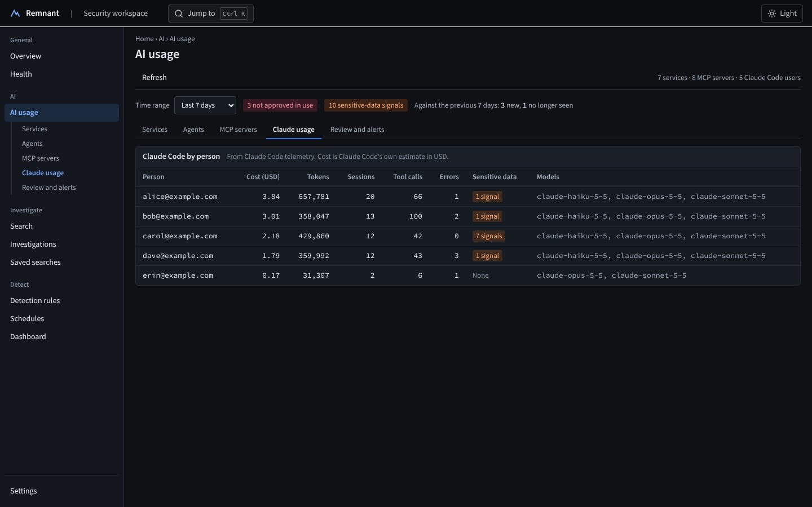
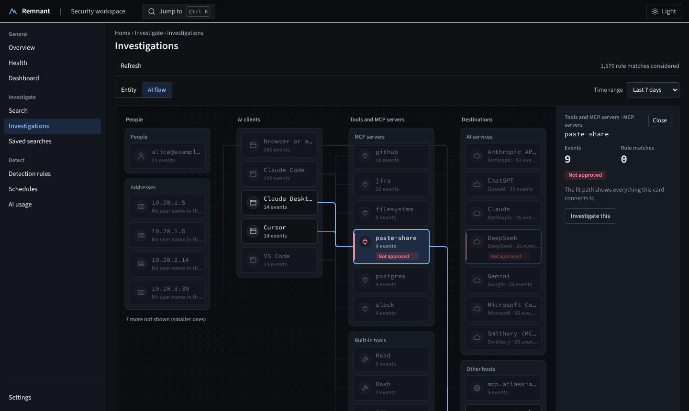
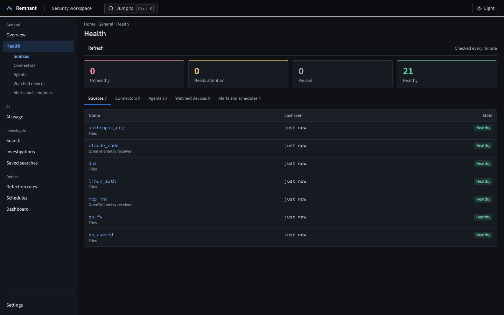
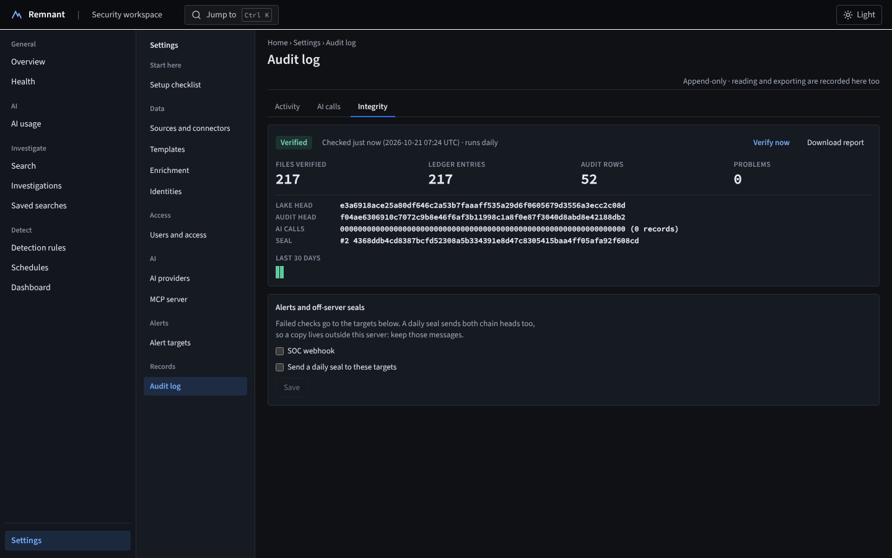
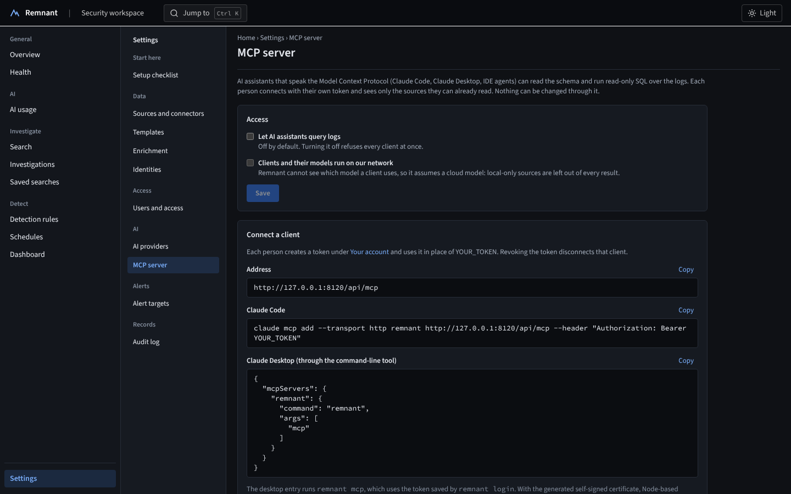

# remnant

**See the AI your company actually uses.** Self-hosted AI usage monitoring: find shadow AI, AI agents, and MCP servers in the logs you already have, then approve, alert, and audit.

> Status: early preview (Slices 1 to 8 built; a few connectors deferred). Expect rough edges. "Remnant" is a working codename.

Your DNS, firewall, and proxy logs already show which AI services people reach. Claude Code telemetry and a small endpoint inventory show which agents run, which MCP servers they use, and what they cost. Remnant brings those together on your own server, lets you mark each one Approved or Not approved, alerts you when something new or unapproved shows up or sensitive data heads to AI, and keeps a tamper-evident record of all of it.

Under it is a small, local-first log platform: syslog, files, Windows, and Microsoft 365 parsed into OCSF columns, DuckDB search, Sigma detections, and an optional assistant (your own model by default) that never runs anything on its own.



## Where it sits



Browser chat is seen by the sites people reach (who, when, how often), not by what they type. Agent detail comes from telemetry on the machines you set it up on.

| | |
|---|---|
|  |  |
| **Agents.** Claude Code per person, MCP setups per machine, and API keys, each compared with its own last 30 days: new tools, new MCP servers, unusual busy hours | **MCP servers.** Installed (endpoint inventory) and used (telemetry), who uses them, and New ones marked; approve or flag each |
|  |  |
| **Claude usage.** Cost, tokens, sessions, tool calls, errors, and sensitive-data signals per person | **AI flow.** People to clients to MCP servers and AI services in lanes, with not approved paths marked |
|  |  |
| **Overview.** Events per source and hour, with hours outlined when they are far busier than the week before | **Health.** Every source, connector, agent, and alert target, plus watched devices that alert when they go quiet |
|  |  |
| **Search.** Type `sshd "failed password"`, or SQL, or ask in plain English with a local model; the SQL is always shown before it runs | **Dashboard.** Scheduled searches and Sigma rules with thresholds and alerts |
|  |  |
| **Integrity.** Stored logs, the audit log, and AI call records hash-chained and checked daily, with signed seals | **MCP server.** Claude Code, Claude Desktop, and other assistants query the logs read-only, as the person who connects them |
|  |  |
| **Ctrl+K** goes to any page, saved search, or source | A complete light theme as well as dark |

Screenshots use made-up logs from `scripts/loggen.py` and `scripts/demo_lab.py`.

## What it does

**AI usage**

- **AI services.** Which AI sites and APIs people use, matched by domain from DNS, firewall, and proxy logs against a built-in catalog you can extend; New and No longer seen against the period before.
- **Agents and MCP servers.** Claude Code telemetry and an endpoint MCP inventory: which agents and clients run, which MCP servers and tools they use, who uses them, and what changed.
- **Claude usage per person.** Sessions, tokens, cost, tool calls, errors, and sensitive-data signals (keys, card numbers, personal data) in prompts.
- **Review and alerts.** Mark each service and MCP server Approved or Not approved, set the data each may receive, and get one alert per first sighting of unapproved use, sensitive data, or an agent change.
- **Evidence.** Every AI call, review, and admin action lands in an append-only audit log; the audit log, AI call records, and stored logs are hash-chained, checked daily, and sealed with optional copies sent off the server.

**The log platform underneath**

- **Bring your own logs.** Syslog over UDP, TCP, or TLS, files and folders (rsyslog, syslog-ng, Vector), JSON lines, CSV, Windows EVTX and forwarded events, or a Grafana Loki you already run. 31 starter parsers (Linux auth, Palo Alto, Fortinet, UniFi, Cisco ASA and IOS, CEF, LEEF, Windows, DNS including PowerDNS, Authelia, TACACS+, Vault, OpenVPN, OpenLDAP) and an Automatic parser for mixed streams.
- **Connect cloud services.** Microsoft 365 (audit logs, Entra sign-ins, directory audits, alerts) and the Anthropic admin API (usage, cost, Claude Code). Works through an outbound proxy if you need one.
- **Search three ways** over one engine: Simple search, SQL (read-only, guarded), or Ask in plain English.
- **Detect** with imported SigmaHQ rules and scheduled searches; alert to email, Teams, Slack, or a signed webhook; send selected events to a ticket system or chat.
- **Know it is working.** A Health page for every source, connector, agent, and alert target, plus watched devices that alert when they go silent.
- **Investigate.** Users, addresses, and hosts ranked by rule matches; one person counted once across `alice`, `CORP\alice`, and `alice@example.com`; optional GeoIP and threat intel lookups, all local.

**AI you can trust with logs**

- **Bring your own model.** Ollama, LM Studio, llama.cpp, vLLM, or any OpenAI-compatible API, plus Anthropic. Fresh installs allow local models only. Each source is Local only or Cloud allowed, and Local only data is blocked from cloud models in code.
- **Treats log content as hostile.** The model never reads the whole dataset, never runs anything on its own, and every claim it makes cites event ids that are checked.
- **Team ready.** Accounts, roles, per-source access, HTTPS by default, optional single sign-on, online backups.

## Quick start (Docker Compose)

You need a Linux machine or VM with [Docker Engine and the Compose plugin](https://docs.docker.com/engine/install/), 2 vCPU, 4 GB RAM, and 20 GB of disk. A Proxmox LXC works (unprivileged, with `nesting` and `keyctl` on).

**1. Get it and start it**

```bash
git clone https://github.com/Err0ric/remnant
cd remnant
cp .env.example .env
docker compose up -d --build
```

**2. Create the administrator account.** The first start prints a one-time link (valid 30 minutes) and the certificate fingerprint:

```bash
docker compose logs app | grep -A1 "one-time link"
docker compose logs app | grep "SHA-256"
```

Open the link, check that the fingerprint in the browser's certificate warning matches the log line, and create the administrator.

**3. Add logs.** Put log files (or point a collector) in the folder set by `LOGS_DIR` in `.env` (default `./logs`); it appears in the app as `/logs`. Then **Settings > Sources and connectors > Add source**, pick the folder, and leave the parser on **Automatic** (CSV files use **Generic: CSV with a header row**). To try it with made-up logs first:

```bash
docker compose --profile demo up -d     # 24 hours of synthetic logs in ./logs/demo, then a live trickle
```

The demo writes syslog, JSON, and CSV folders under `/logs/demo`; [homelab-test.md](docs/install/homelab-test.md) lists the three sources to add and what to try next.

**4. Optional: a local model for Ask**

```bash
docker compose --profile ollama up -d
docker compose exec ollama ollama pull qwen3.5:9b
```

Then **Settings > AI providers**: edit **Local Ollama**, pick the model, set **Thinking** to **Off**, and **Enable**. Only local models are allowed until you choose otherwise.

### Reach it from other machines

By default it listens on `127.0.0.1:8080` only. For a team server, set these in `.env` and run `docker compose up -d` again:

```
APP_BIND=0.0.0.0
APP_PUBLIC_NAME=siem.example.internal   # the name people type; used in links and the certificate
LOGS_DIR=/var/log/remote                # where your collector writes
LOGS_GID=4                              # group that can read those files (adm on Debian/Ubuntu)
```

Anything reachable from the network requires sign-in and HTTPS; there is no switch to turn that off.

### Updating

```bash
git pull && docker compose up -d --build
```

Database changes apply at start and only ever add to what is there. Take a backup first: `docker compose exec -T app app-admin backup -o - > backup.tar.gz` ([details](docs/install/backup.md)).

### More install options

| Guide | For |
|---|---|
| [docs/install/team-vm.md](docs/install/team-vm.md) | A shared server: Docker Compose or a systemd service, accounts, roles, source access |
| [docs/install/first-real-data.md](docs/install/first-real-data.md) | A first-week checklist on real logs: firewall syslog, Microsoft 365, rules, AI usage |
| [docs/install/m365.md](docs/install/m365.md) | Microsoft 365 audit, Entra sign-ins, and alerts, with the exact permissions |
| [docs/install/ai-usage.md](docs/install/ai-usage.md) | Seeing AI use: network logs, [Claude Code telemetry](docs/install/claude-code-telemetry.md), [MCP inventory](docs/install/mcp-inventory.md), [endpoint agent](docs/install/endpoint-agent.md), [Anthropic admin API](docs/install/anthropic-admin-api.md) |
| [docs/install/proxy.md](docs/install/proxy.md) | An outbound HTTPS proxy for the cloud connectors and Teams or Slack alerts |
| [docs/install/single-user.md](docs/install/single-user.md) | One person on a laptop, from source or Docker |
| [docs/install/homelab-test.md](docs/install/homelab-test.md) | A guided first run with made-up logs, every screen |
| [docs/install/team-trial-loki.md](docs/install/team-trial-loki.md) | Reading from a Grafana Loki you already run |
| [docs/install/offline.md](docs/install/offline.md) | Servers without internet access, or behind a proxy that breaks the build: build elsewhere, carry one folder |
| [docs/install/syslog-listener.md](docs/install/syslog-listener.md) | Sending syslog straight to Remnant over UDP, TCP, or TLS |
| [docs/ingest/](docs/ingest/) | Pointing rsyslog, syslog-ng, or Vector at the log folder |
| [docs/install/mcp-server.md](docs/install/mcp-server.md) | Querying the logs from Claude Code, Claude Desktop, or another MCP client |
| [docs/install/sso-entra.md](docs/install/sso-entra.md), [sso-authelia.md](docs/install/sso-authelia.md) | Sign-in with Microsoft Entra ID, Authelia, or another OIDC provider |
| [docs/install/backup.md](docs/install/backup.md) | Backups, restore, moving to a new server |
| [docs/install/integrity.md](docs/install/integrity.md) | Log integrity checks, seals, and the integrity report |
| [docs/install/enrichment.md](docs/install/enrichment.md) | GeoIP and threat intel, looked up locally and kept current |
| [docs/install/handoff.md](docs/install/handoff.md) | Sending selected events to a ticket system, chat, or mailbox |
| [docs/install/quiet-sources.md](docs/install/quiet-sources.md) | An alert when a source stops sending |
| [docs/install/health.md](docs/install/health.md) | The Health page: sources, connectors, agents, watched devices, alert targets |
| [docs/install/tls.md](docs/install/tls.md) | Using your own certificate |

## Docs

| Doc | What it covers |
|---|---|
| [docs/SPEC.md](docs/SPEC.md) | Architecture, schemas, threat model, roadmap, decisions |
| [docs/DESIGN.md](docs/DESIGN.md) | UI tokens, typography, component patterns |
| [docs/api.md](docs/api.md) | API reference: every endpoint, tokens, errors, a curl example |
| [docs/searching.md](docs/searching.md) | Writing searches that keep working when a parser changes |
| [docs/adr/](docs/adr/) | One file per design decision |
| [CLAUDE.md](CLAUDE.md) | Build rules, conventions, tests, definition of done |
| [SECURITY.md](SECURITY.md) | Reporting a vulnerability |

## Development

Requirements: Python 3.12 with [uv](https://docs.astral.sh/uv/), Node 22 with pnpm.

```bash
make dev-backend    # API on http://127.0.0.1:8080
make dev-frontend   # UI on http://127.0.0.1:5173 (proxies /api)
make ci             # architecture checks, lint, types, tests, build
```

### Command line

```bash
cd backend
uv run app-admin ingest /var/log/auth.log --source linux_auth          # syslog is the default
uv run app-admin ingest events.jsonl --source winlogbeat --format json
uv run app-server                                                       # API on 127.0.0.1:8080

# in another terminal
uv run remnant login --server https://siem.corp.example:8080   # once; token goes to the OS keychain
uv run remnant tail linux_auth -n 20
uv run remnant tail linux_auth -f --where "message LIKE 'Failed%'"
uv run remnant query "SELECT device_hostname, count(*) FROM events GROUP BY 1" -o csv
uv sync --extra tui && uv run remnant tui --source linux_auth   # full-screen: query box, results, live tail
```

Scripts and other tools can call the same JSON API with a personal token: see [docs/api.md](docs/api.md).

`app-admin ingest` does a one-off load; for continuous tailing add a source on the **Sources** page. The CLI only talks to the server API, with the same SQL guard as the web UI. Output formats: `table`, `json` (one object per line), `csv`, `raw`.

## Tested scale

Measured with `scripts/bench.py` (synthetic syslog through the real ingest path with the Automatic parser, then searches through the real query API), on a 2 vCPU Intel Xeon 2.1 GHz cloud VM with 8 GB RAM:

| Measure | Result |
|---|---|
| Ingest | about 9,600 events/s for one source (854,316 events in 89 s) |
| Storage | 117.7 MB of raw syslog became a 54.1 MB lake (2.2x smaller), raw lines kept |
| Count, group by host, failed logins by IP | 40 to 45 ms |
| Text search in `message` (`ILIKE`) | 270 ms |
| Latest 100 events, all columns | 340 ms |

On a 4 vCPU Proxmox container (AMD Ryzen 9 5950X host, 8 GB RAM), the same run gave about 14,700 events/s; 16 to 19 ms for count, group by host, and failed logins by IP; 96 ms for the text search; and 110 ms for the latest 100 events.

Run it on your own hardware with `cd backend && uv run python ../scripts/bench.py --events 1000000`. A Loki source reads at most 20,000 lines per 30 s poll (about 650 lines/s), well inside the ingest rate.

Investigation pages read many events at once. On a 14 million event lake over 7 days (synthetic network, sign-in, and AI telemetry across 800 people, written straight to Parquet), on a 2 vCPU cloud container:

| Page | Time |
|---|---|
| AI usage | 4.9 s |
| Investigations, AI flow, everyone | 4.4 s |
| Investigations, AI flow, one person | 4.8 s |
| Investigations, one user's lanes | 3.0 s |
| Settings, Identities (suggestions) | 6.4 s |

Each stays under the 20 s query limit; shorter time ranges are proportionally faster.

## Software bill of materials

Every CI run publishes `sbom.cdx.json` (CycloneDX 1.5) as a build artifact: the Python packages and web UI packages that ship in the image, with hashes, plus the container base images. Development tools are left out. To make one locally:

```
cd backend && uv run python ../scripts/sbom.py --out ../sbom.cdx.json
```

It is built from `uv.lock`, `pnpm-lock.yaml`, and the `Dockerfile`, so the same commit always gives the same file.

## Security

Report vulnerabilities privately; see [SECURITY.md](SECURITY.md).

## License

Apache 2.0
