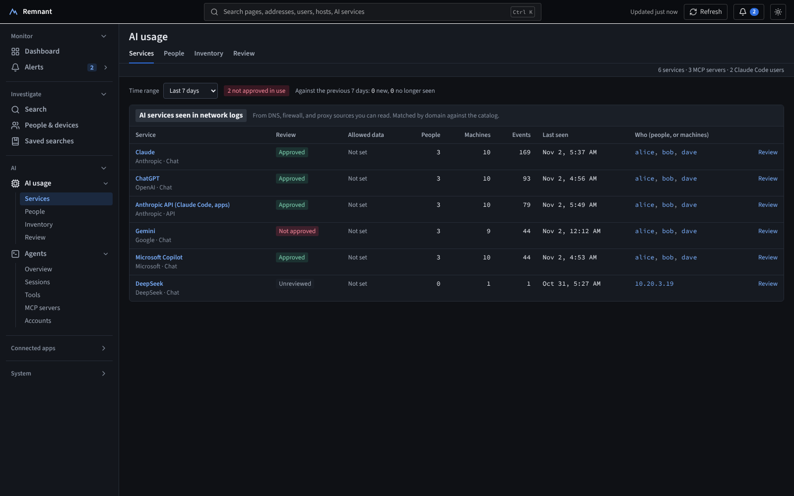
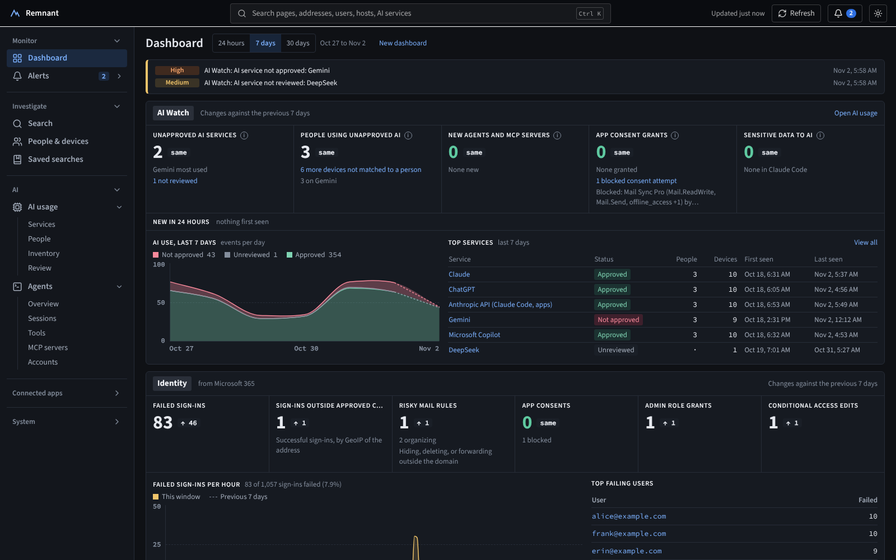
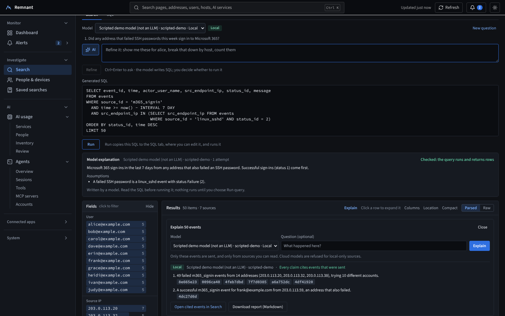
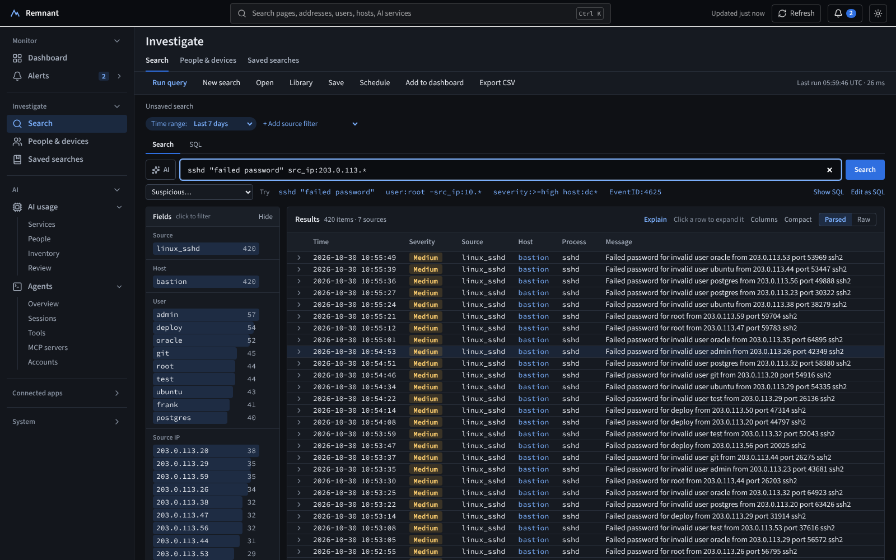
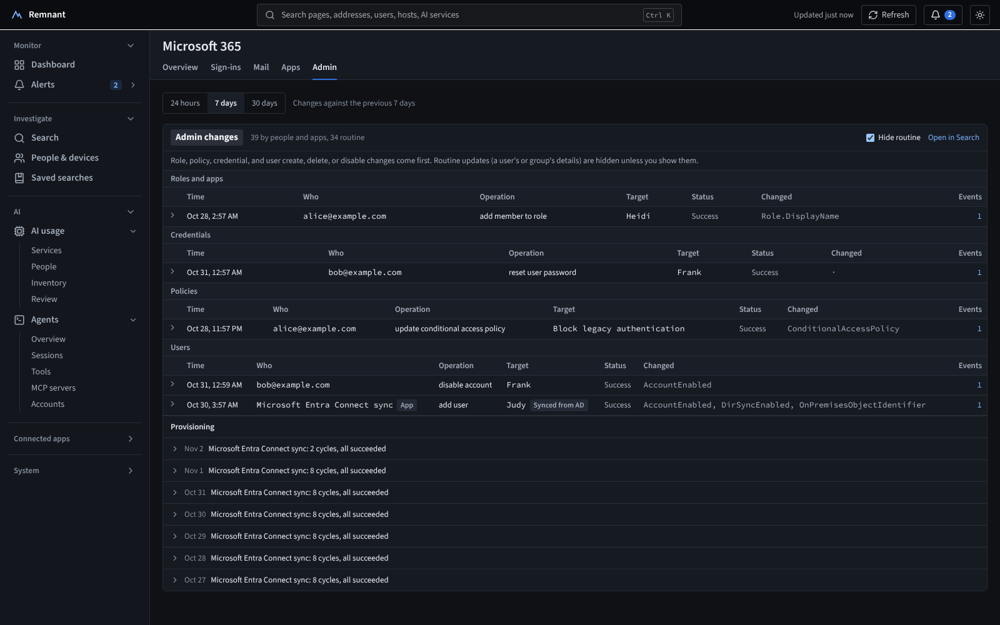
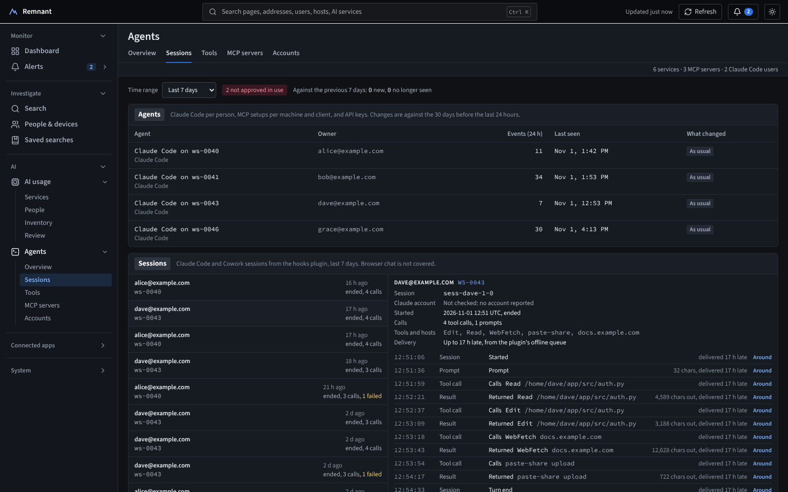
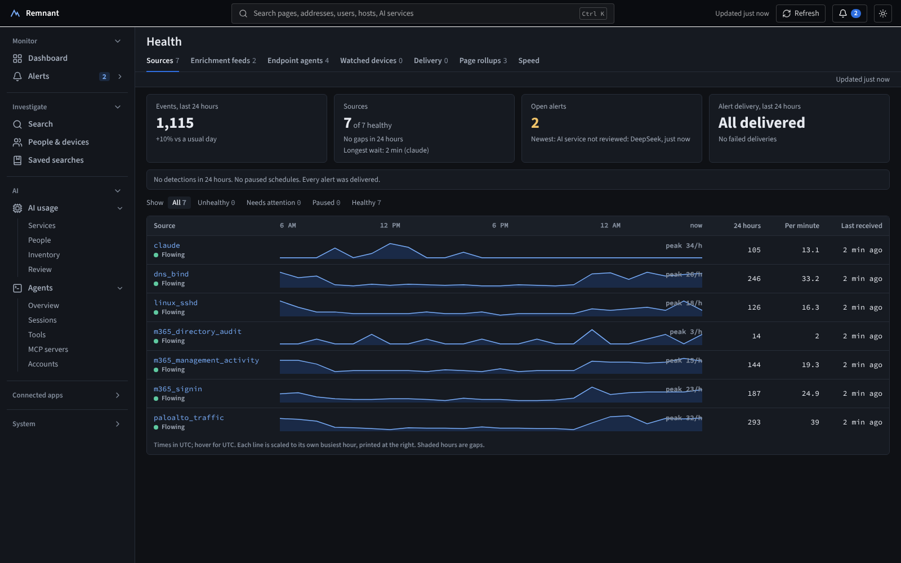
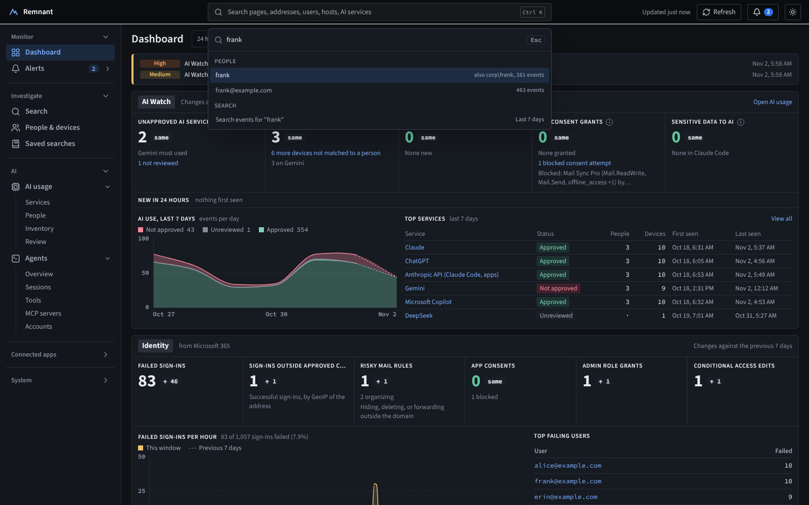
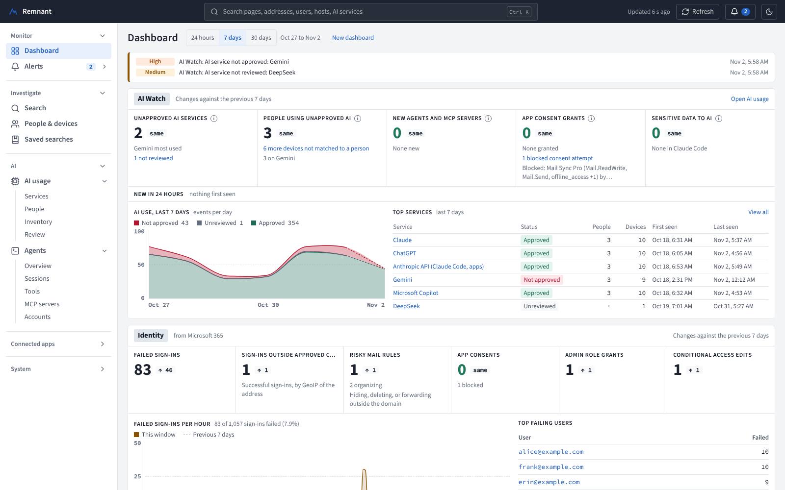
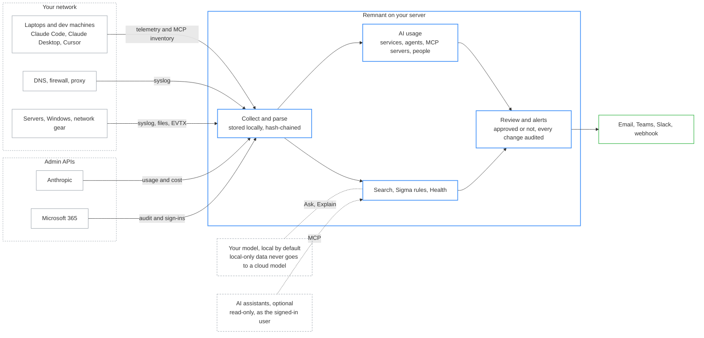

# Remnant

**See the AI your company actually uses.** Self-hosted AI usage monitoring on a local-first, LLM-assisted SIEM: find shadow AI, AI agents, and MCP servers in the logs you already have, then approve, alert, and audit.


Your DNS, firewall, and proxy logs already show which AI services people reach. Claude Code telemetry and a small endpoint inventory show which agents run, which MCP servers they use, and what they cost. Remnant brings those together on your own server, lets you mark each one Approved or Not approved, alerts you when something new or unapproved shows up or sensitive data heads to AI, and keeps a tamper-evident record of all of it.

Under it is a small, local-first log platform: syslog, files, Windows, and Microsoft 365 parsed into OCSF columns, DuckDB search, Sigma detections, and an optional assistant (your own model by default) that never runs anything on its own.



> **Status: early preview.** The core platform, AI usage views, Microsoft 365 and Anthropic connectors, enrichment, and integrity checks are built; a few connectors are planned. Expect rough edges. "Remnant" is a working codename.

## Why Remnant

- **Your logs, your server.** Everything is stored and searched locally. Nothing leaves unless you connect a cloud model, and sources marked Local only are blocked from cloud models in code.
- **Bring your own logs.** 39 starter parsers (firewalls, network gear, Linux, Windows, DNS, Microsoft 365, AI telemetry) mapped to OCSF, plus an Automatic parser and a model-assisted parser draft for anything else.
- **Bring your own model.** Ollama, LM Studio, llama.cpp, vLLM, any OpenAI-compatible API, or Anthropic. The model writes queries and explains results; a deterministic engine does the work, and every claim cites event ids that are checked.

## What it does

**AI usage**

- **AI services.** Which AI sites and APIs people use, matched by domain from DNS, firewall, and proxy logs against a built-in catalog you can extend; New and No longer seen against the period before.
- **Agents and MCP servers.** Claude Code telemetry and an endpoint MCP inventory: which agents and clients run, which MCP servers and tools they use, who uses them, and what changed.
- **Claude usage per person.** Sessions, tokens, cost, tool calls, errors, and sensitive-data signals (keys, card numbers, personal data) in prompts.
- **Review and alerts.** Mark each service and MCP server Approved or Not approved, set the data each may receive, and get one alert per first sighting of unapproved use, sensitive data, or an agent change.
- **Evidence.** Every AI call, review, and admin action lands in an append-only audit log; the audit log, AI call records, and stored logs are hash-chained, checked daily, and sealed with optional copies sent off the server.

**The log platform underneath**

- **Bring your own logs.** Syslog over UDP, TCP, or TLS, files and folders (rsyslog, syslog-ng, Vector), JSON lines, CSV, Windows EVTX and forwarded events, or a Grafana Loki you already run. 39 starter parsers (Linux auth, Palo Alto, Fortinet, UniFi, Cisco ASA and IOS, CEF, LEEF, Windows, DNS including PowerDNS, Authelia, TACACS+, Vault, OpenVPN, OpenLDAP) and an Automatic parser for mixed streams.
- **Connect cloud services.** Microsoft 365 (audit logs, Entra sign-ins, directory audits, alerts) and the Anthropic admin API (usage, cost, Claude Code). Works through an outbound proxy if you need one.
- **Search three ways** over one engine: Simple search, SQL (read-only, guarded), or Ask in plain English.
- **Detect** with imported SigmaHQ rules and scheduled searches; alert to email, Teams, Slack, or a signed webhook; send selected events to a ticket system or chat.
- **Know it is working.** A Health page for every source, connector, agent, and alert target, plus watched devices that alert when they go silent.
- **Investigate.** Users, addresses, and hosts ranked by rule matches; one person counted once across `alice`, `CORP\alice`, and `alice@example.com`; optional GeoIP and threat intel lookups, all local.

**AI you can trust with logs**

- **Bring your own model.** Ollama, LM Studio, llama.cpp, vLLM, or any OpenAI-compatible API, plus Anthropic. Fresh installs allow local models only. Each source is Local only or Cloud allowed, and Local only data is blocked from cloud models in code.
- **Treats log content as hostile.** The model never reads the whole dataset, never runs anything on its own, and every claim it makes cites event ids that are checked.
- **Team ready.** Accounts, roles, per-source access, HTTPS by default, optional single sign-on, online backups.

## Screenshots

All screenshots come from the demo install below: two weeks of made-up logs for a fictional company (Example Corp at example.com), with a password-spraying attack on Microsoft 365 and SSH, a mailbox rule forwarding invoices outside, a blocked app consent, and an AI service nobody has reviewed.

| | |
|---|---|
|  |  |
| **Dashboard.** AI Watch, AI use by review status, and Microsoft 365 signals, each against the week before | **Ask.** A question in plain English, the SQL shown before it runs, and an explanation whose every claim cites events that were sent (here a scripted stand-in, labeled as one, answers instead of a model) |
|  |  |
| **Search.** `sshd "failed password" src_ip:203.0.113.*` with field counts beside the results | **Microsoft 365 > Admin.** Role, policy, credential, and user changes first, routine updates hidden, directory sync grouped per day |
|  |  |
| **AI usage.** Services from DNS, firewall, and proxy logs, matched against the catalog, with who uses them | **Agents.** Claude Code per person and machine, and one session step by step, including a not approved MCP server |
|  |  |
| **Health.** Every source, connector, agent, and alert target, with gaps shaded | **Ctrl+K** goes to any page, person, saved search, or source |
|  | |
| A complete light theme as well as dark | |

## Try the demo

On a machine with [uv](https://docs.astral.sh/uv/) and Node.js (no Docker needed):

```bash
cd frontend && pnpm install && pnpm build && cd ..
make demo
```

Then open http://127.0.0.1:8090. `make demo` writes synthetic logs to `data/demo/`, starts a throwaway server on loopback (no accounts), and loads them with a synthetic GeoIP file. Everything in it is made up: example.com people, documentation-range addresses, invented hosts. The demo loads two weeks at once, so Claude Code hook records show as delivered late. `scripts/screenshots/capture.py` takes the screenshots above from it.

## Where it sits



Browser chat is seen by the sites people reach (who, when, how often), not by what they type. Agent detail comes from telemetry on the machines you set it up on.

## Quick start (Docker Compose)

You need a Linux machine or VM with [Docker Engine and the Compose plugin](https://docs.docker.com/engine/install/), 2 vCPU, 4 GB RAM, and 20 GB of disk. A Proxmox LXC works (unprivileged, with `nesting` and `keyctl` on).

**1. Get it and start it**

```bash
git clone https://github.com/Err0ric/remnant
cd remnant
cp .env.example .env
docker compose up -d --build
```

**2. Create the administrator account.** The first start prints a one-time link (valid 30 minutes) and the certificate fingerprint:

```bash
docker compose logs app | grep -A1 "one-time link"
docker compose logs app | grep "SHA-256"
```

Open the link, check that the fingerprint in the browser's certificate warning matches the log line, and create the administrator.

**3. Add logs.** Put log files (or point a collector) in the folder set by `LOGS_DIR` in `.env` (default `./logs`); it appears in the app as `/logs`. Then **Settings > Sources and connectors > Add source**, pick the folder, and leave the parser on **Automatic** (CSV files use **Generic: CSV with a header row**). To try it with made-up logs first:

```bash
docker compose --profile demo up -d     # 24 hours of synthetic logs in ./logs/demo, then a live trickle
```

The demo writes syslog, JSON, and CSV folders under `/logs/demo`; [homelab-test.md](docs/install/homelab-test.md) lists the three sources to add and what to try next.

**4. Optional: a local model for Ask**

```bash
docker compose --profile ollama up -d
docker compose exec ollama ollama pull qwen3.5:9b
```

Then **Settings > AI providers**: edit **Local Ollama**, pick the model, set **Thinking** to **Off**, and **Enable**. Only local models are allowed until you choose otherwise.

### Reach it from other machines

By default it listens on `127.0.0.1:8080` only. For a team server, set these in `.env` and run `docker compose up -d` again:

```
APP_BIND=0.0.0.0
APP_PUBLIC_NAME=siem.example.internal   # the name people type; used in links and the certificate
LOGS_DIR=/var/log/remote                # where your collector writes
LOGS_GID=4                              # group that can read those files (adm on Debian/Ubuntu)
```

Anything reachable from the network requires sign-in and HTTPS; there is no switch to turn that off.

### Updating

```bash
git pull && GIT_COMMIT=$(git rev-parse HEAD) docker compose up -d --build
```

Database changes apply at start and only ever add to what is there. Take a backup first: `docker compose exec -T app app-admin backup -o - > backup.tar.gz` ([details](docs/install/backup.md)).

## Supported log sources

| Category | Starter parsers |
|---|---|
| Firewalls and VPN | Palo Alto (traffic, threat, system, GlobalProtect, User-ID), Fortinet FortiGate, Cisco ASA, OpenVPN |
| Network gear | Cisco IOS, UniFi, TACACS+ |
| Linux | sshd, sudo, PAM, systemd, OpenLDAP |
| Windows | EVTX files, NXLog JSON, Snare, Winlogbeat |
| DNS | BIND, Unbound, PowerDNS, Windows DNS |
| Identity and secrets | Microsoft 365 sign-ins, directory audit, management activity and alerts; Authelia; HashiCorp Vault (audit and server); this server's own refused sign-ins and tokens |
| AI usage | Claude Code telemetry (OpenTelemetry), Claude Code hooks, MCP inventory, Anthropic admin reports |
| Generic formats | CEF, LEEF, JSON over syslog, JSON lines, CSV with a header row |

Anything else: point a source at it and let the Automatic parser try, or have the assistant draft a template from a sample and approve it yourself. Templates are plain YAML in [templates/starter/](templates/starter/).

## Bring your own model

| Provider | How | Notes |
|---|---|---|
| Ollama, LM Studio, llama.cpp, vLLM | OpenAI-compatible API | Local by default; an Ollama profile ships in `docker-compose.yml` |
| Any OpenAI-compatible service | OpenAI-compatible API | Treated as cloud: only Cloud allowed sources can reach it |
| Anthropic | Native adapter | Treated as cloud |
| None | | Ingest, search, Sigma rules, dashboards, and alerts all work with no model at all |

Fresh installs allow local models only. Every model call is written to the audit log with hashes of the prompt and response.

## Security and privacy

- **Log content is treated as hostile.** It is rendered as text only, never run, and passed to the model as data with instructions to ignore any instructions inside it (indirect prompt injection, MITRE ATLAS AML.T0051.001).
- **The model has no write access.** Ask mode has two read-only tools; every query is shown before it runs and goes through a SQL allowlist on a read-only engine.
- **Local only means local only.** Sources marked Local only can never be sent to a cloud model (LLM data leakage, ATLAS AML.T0057), with optional redaction for the rest.
- **Accounts and access.** Sign-in and HTTPS are required off the local machine, with roles, per-source access, and optional single sign-on.
- **Tamper evidence.** Stored logs, the audit log, and model call records are hash-chained, checked daily, and can be sealed with signed copies sent off the server.

The threat model is in [docs/SPEC.md](docs/SPEC.md) section 7. Report vulnerabilities privately: see [SECURITY.md](SECURITY.md).

## Install guides

| Guide | For |
|---|---|
| [docs/install/team-vm.md](docs/install/team-vm.md) | A shared server: Docker Compose or a systemd service, accounts, roles, source access |
| [docs/install/first-real-data.md](docs/install/first-real-data.md) | A first-week checklist on real logs: firewall syslog, Microsoft 365, rules, AI usage |
| [docs/install/m365.md](docs/install/m365.md) | Microsoft 365 audit, Entra sign-ins, and alerts, with the exact permissions |
| [docs/install/ai-usage.md](docs/install/ai-usage.md) | Seeing AI use: network logs, [Claude Code telemetry](docs/install/claude-code-telemetry.md), [MCP inventory](docs/install/mcp-inventory.md), [endpoint agent](docs/install/endpoint-agent.md), [Anthropic admin API](docs/install/anthropic-admin-api.md) |
| [docs/install/proxy.md](docs/install/proxy.md) | An outbound HTTPS proxy for the cloud connectors and Teams or Slack alerts |
| [docs/install/single-user.md](docs/install/single-user.md) | One person on a laptop, from source or Docker |
| [docs/install/homelab-test.md](docs/install/homelab-test.md) | A guided first run with made-up logs, every screen |
| [docs/install/team-trial-loki.md](docs/install/team-trial-loki.md) | Reading from a Grafana Loki you already run |
| [docs/install/offline.md](docs/install/offline.md) | Servers without internet access, or behind a proxy that breaks the build: build elsewhere, carry one folder |
| [docs/install/syslog-listener.md](docs/install/syslog-listener.md) | Sending syslog straight to Remnant over UDP, TCP, or TLS |
| [docs/ingest/](docs/ingest/) | Pointing rsyslog, syslog-ng, or Vector at the log folder |
| [docs/install/mcp-server.md](docs/install/mcp-server.md) | Querying the logs from Claude Code, Claude Desktop, or another MCP client |
| [docs/install/sso-entra.md](docs/install/sso-entra.md), [sso-authelia.md](docs/install/sso-authelia.md) | Sign-in with Microsoft Entra ID, Authelia, or another OIDC provider |
| [docs/install/backup.md](docs/install/backup.md) | Backups, restore, moving to a new server |
| [docs/install/integrity.md](docs/install/integrity.md) | Log integrity checks, seals, and the integrity report |
| [docs/install/enrichment.md](docs/install/enrichment.md) | GeoIP and threat intel, looked up locally and kept current |
| [docs/install/handoff.md](docs/install/handoff.md) | Sending selected events to a ticket system, chat, or mailbox |
| [docs/install/quiet-sources.md](docs/install/quiet-sources.md) | An alert when a source stops sending |
| [docs/install/health.md](docs/install/health.md) | The Health page: sources, connectors, agents, watched devices, alert targets |
| [docs/install/tls.md](docs/install/tls.md) | Using your own certificate |

## Documentation

| Doc | What it covers |
|---|---|
| [docs/SPEC.md](docs/SPEC.md) | Architecture, schemas, threat model, roadmap, decisions |
| [docs/DESIGN.md](docs/DESIGN.md) | UI tokens, typography, component patterns |
| [docs/api.md](docs/api.md) | API reference: every endpoint, tokens, errors, a curl example |
| [docs/searching.md](docs/searching.md) | Writing searches that keep working when a parser changes |
| [docs/adr/](docs/adr/) | One file per design decision |
| [docs/development.md](docs/development.md) | Building from source, tests, the command line, SBOM |
| [docs/performance.md](docs/performance.md) | Tested ingest rate, lake size, query and page times, local model results |
| [CLAUDE.md](CLAUDE.md) | Build rules, conventions, tests, definition of done |
| [SECURITY.md](SECURITY.md) | Reporting a vulnerability |

## Roadmap

Planned, in rough order: Okta, Google Workspace, and AWS CloudTrail connectors; an object-storage tier for older data, queried in place; and more starter parsers. See [docs/BACKLOG.md](docs/BACKLOG.md) and the decision log in [docs/SPEC.md](docs/SPEC.md).

## Contributing

Parser templates, bug reports, and docs fixes are the most useful contributions. See [CONTRIBUTING.md](CONTRIBUTING.md). Building from source and running the tests: [docs/development.md](docs/development.md).

## License

Apache 2.0. See [LICENSE](LICENSE).
