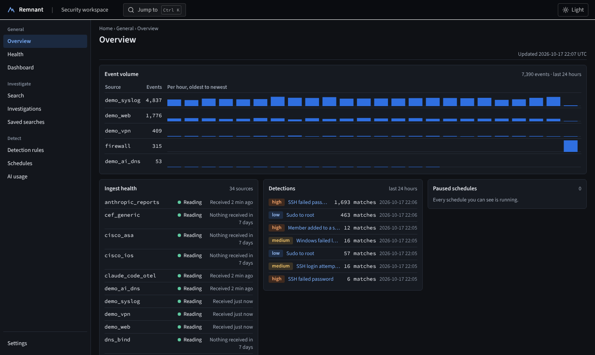
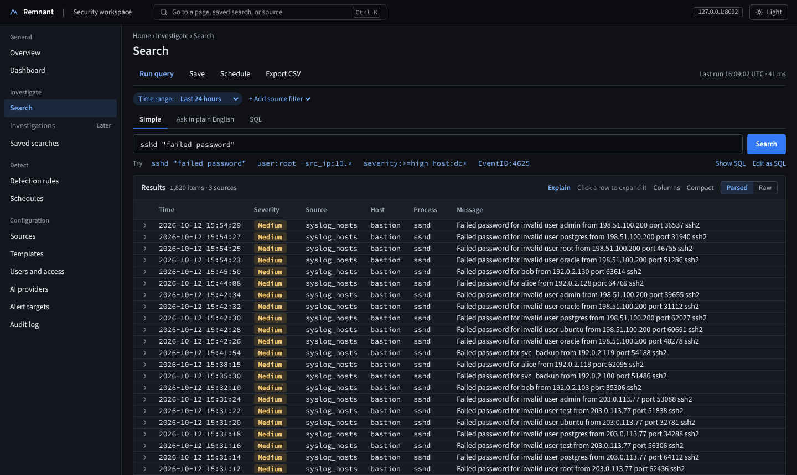
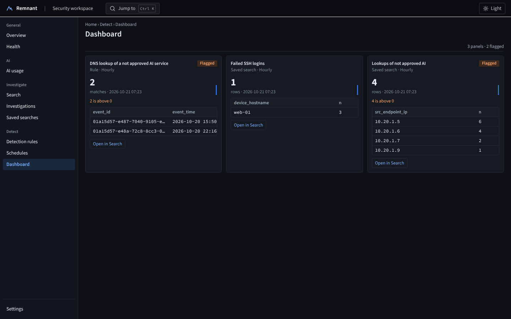
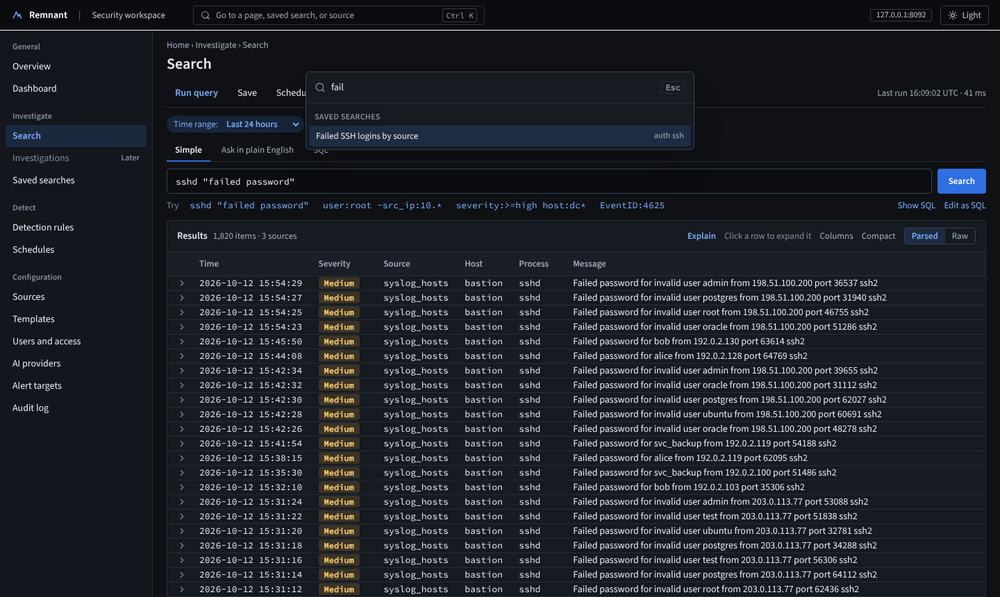
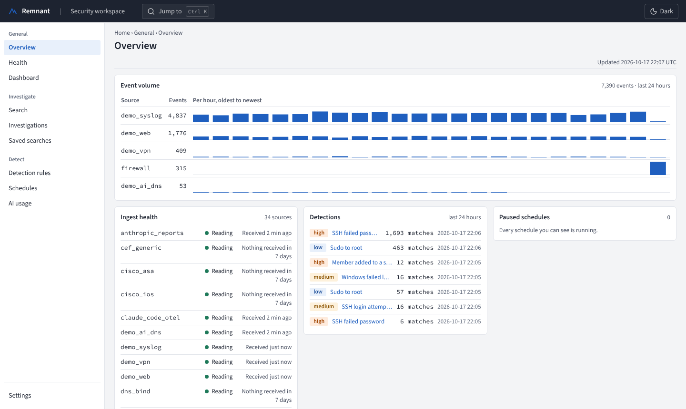
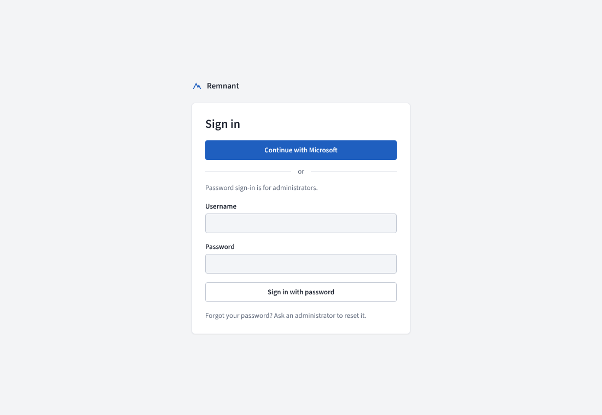
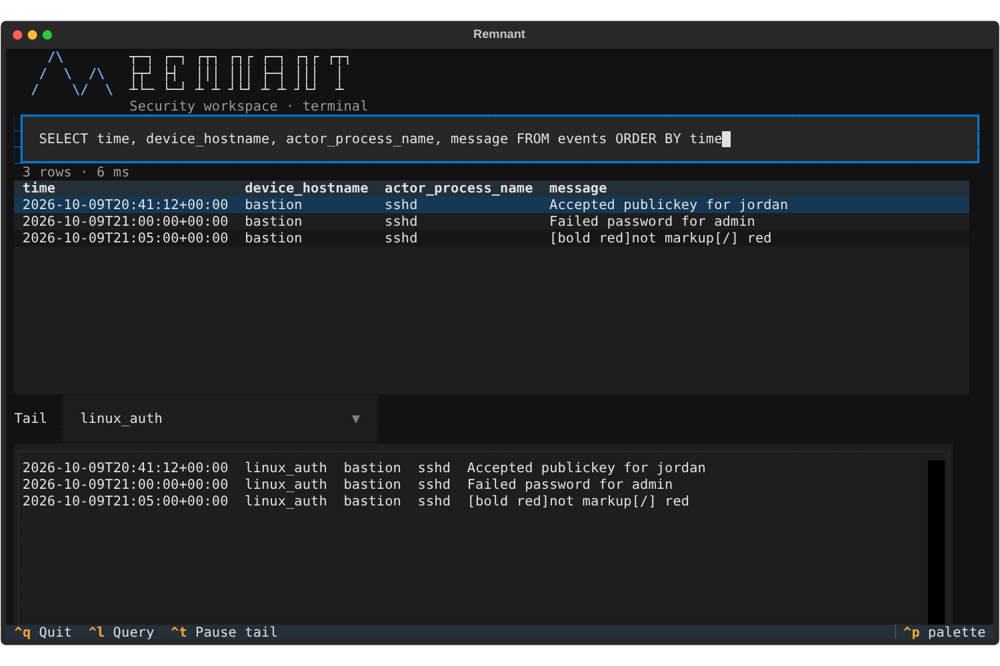

# remnant

Local-first, LLM-assisted SIEM front end. Bring your own logs, bring your own model.

> Status: early preview (Slices 1 to 5 built, Slice 6 polish nearly done). Expect rough edges. "Remnant" is a working codename.

Point it at log files you already have. Templates parse them into OCSF columns in a Parquet lake, DuckDB queries them, Sigma detects on them, and an LLM (local by default) helps write parsers and queries and explains results with citations back to real events.



| | |
|---|---|
|  |  |
| **Search.** Type `sshd "failed password"`, or SQL, or ask in plain English with a local model; the SQL is always shown before it runs | **Dashboard.** Scheduled searches and Sigma rules with thresholds, sparklines, and alerts to email, Teams, Slack, or a webhook |
|  |  |
| **Ctrl+K** goes to any page, saved search, or source | A complete light theme as well as dark |
|  |  |
| Optional sign-in with Microsoft Entra ID, Authelia, or any OIDC provider | `remnant tui`: query, results, and a live tail in the terminal |

Screenshots use made-up logs from `scripts/loggen.py`.

## What it does

- **Bring your own logs.** Files and folders (rsyslog, syslog-ng, Vector), JSON lines, CSV, Windows EVTX and forwarded events, or a Grafana Loki you already run. 24 starter parsers (Linux auth, Palo Alto, Fortinet, UniFi, Cisco ASA and IOS, CEF, LEEF, Windows, DNS) and an Automatic parser for mixed streams.
- **Search three ways** over one engine: Simple search, SQL (read-only, guarded), or Ask in plain English.
- **Detect** with imported SigmaHQ rules and scheduled searches; alert to email, Teams, Slack, or a signed webhook.
- **Bring your own model.** Ollama, LM Studio, llama.cpp, vLLM, or any OpenAI-compatible API, plus Anthropic. Fresh installs allow local models only. Each source is Local only or Cloud allowed, and Local only data is blocked from cloud models in code.
- **Treats log content as hostile.** The model never reads the whole dataset, never runs anything on its own, and every claim it makes cites event ids that are checked.
- **Team ready.** Accounts, roles, per-source access, an append-only audit log, HTTPS by default, optional single sign-on, online backups.

## Quick start (Docker Compose)

You need a Linux machine or VM with [Docker Engine and the Compose plugin](https://docs.docker.com/engine/install/), 2 vCPU, 4 GB RAM, and 20 GB of disk. A Proxmox LXC works (unprivileged, with `nesting` and `keyctl` on).

**1. Get it and start it**

```bash
git clone https://github.com/Err0ric/remnant
cd remnant
cp .env.example .env
docker compose up -d --build
```

**2. Create the administrator account.** The first start prints a one-time link (valid 30 minutes) and the certificate fingerprint:

```bash
docker compose logs app | grep -A1 "one-time link"
docker compose logs app | grep "SHA-256"
```

Open the link, check that the fingerprint in the browser's certificate warning matches the log line, and create the administrator.

**3. Add logs.** Put log files (or point a collector) in the folder set by `LOGS_DIR` in `.env` (default `./logs`); it appears in the app as `/logs`. Then **Configuration > Sources > Add source**, pick the folder, and leave the parser on **Automatic** (CSV files use **Generic: CSV with a header row**). To try it with made-up logs first:

```bash
docker compose --profile demo up -d     # 24 hours of synthetic logs in ./logs/demo, then a live trickle
```

The demo writes syslog, JSON, and CSV folders under `/logs/demo`; [homelab-test.md](docs/install/homelab-test.md) lists the three sources to add and what to try next.

**4. Optional: a local model for Ask**

```bash
docker compose --profile ollama up -d
docker compose exec ollama ollama pull qwen3.5:9b
```

Then **Configuration > AI providers**: edit **Local Ollama**, pick the model, set **Thinking** to **Off**, and **Enable**. Only local models are allowed until you choose otherwise.

### Reach it from other machines

By default it listens on `127.0.0.1:8080` only. For a team server, set these in `.env` and run `docker compose up -d` again:

```
APP_BIND=0.0.0.0
APP_PUBLIC_NAME=siem.example.internal   # the name people type; used in links and the certificate
LOGS_DIR=/var/log/remote                # where your collector writes
LOGS_GID=4                              # group that can read those files (adm on Debian/Ubuntu)
```

Anything reachable from the network requires sign-in and HTTPS; there is no switch to turn that off.

### Updating

```bash
git pull && docker compose up -d --build
```

Database changes apply at start and only ever add to what is there. Take a backup first: `docker compose exec -T app app-admin backup -o - > backup.tar.gz` ([details](docs/install/backup.md)).

### More install options

| Guide | For |
|---|---|
| [docs/install/team-vm.md](docs/install/team-vm.md) | A shared server: Docker Compose or a systemd service, accounts, roles, source access |
| [docs/install/single-user.md](docs/install/single-user.md) | One person on a laptop, from source or Docker |
| [docs/install/homelab-test.md](docs/install/homelab-test.md) | A guided first run with made-up logs, every screen |
| [docs/install/team-trial-loki.md](docs/install/team-trial-loki.md) | Reading from a Grafana Loki you already run |
| [docs/install/offline.md](docs/install/offline.md) | Servers without internet access, or behind a proxy that breaks the build: build elsewhere, carry one folder |
| [docs/ingest/](docs/ingest/) | Pointing rsyslog, syslog-ng, or Vector at the log folder |
| [docs/install/sso-entra.md](docs/install/sso-entra.md), [sso-authelia.md](docs/install/sso-authelia.md) | Sign-in with Microsoft Entra ID, Authelia, or another OIDC provider |
| [docs/install/backup.md](docs/install/backup.md) | Backups, restore, moving to a new server |
| [docs/install/quiet-sources.md](docs/install/quiet-sources.md) | An alert when a source stops sending |
| [docs/install/tls.md](docs/install/tls.md) | Using your own certificate |

## Docs

| Doc | What it covers |
|---|---|
| [docs/SPEC.md](docs/SPEC.md) | Architecture, schemas, threat model, roadmap, decisions |
| [docs/DESIGN.md](docs/DESIGN.md) | UI tokens, typography, component patterns |
| [docs/api.md](docs/api.md) | API reference: every endpoint, tokens, errors, a curl example |
| [docs/adr/](docs/adr/) | One file per design decision |
| [CLAUDE.md](CLAUDE.md) | Build rules, conventions, tests, definition of done |
| [SECURITY.md](SECURITY.md) | Reporting a vulnerability |

## Development

Requirements: Python 3.12 with [uv](https://docs.astral.sh/uv/), Node 22 with pnpm.

```bash
make dev-backend    # API on http://127.0.0.1:8080
make dev-frontend   # UI on http://127.0.0.1:5173 (proxies /api)
make ci             # architecture checks, lint, types, tests, build
```

### Command line

```bash
cd backend
uv run app-admin ingest /var/log/auth.log --source linux_auth          # syslog is the default
uv run app-admin ingest events.jsonl --source winlogbeat --format json
uv run app-server                                                       # API on 127.0.0.1:8080

# in another terminal
uv run remnant login --server https://siem.corp.example:8080   # once; token goes to the OS keychain
uv run remnant tail linux_auth -n 20
uv run remnant tail linux_auth -f --where "message LIKE 'Failed%'"
uv run remnant query "SELECT device_hostname, count(*) FROM events GROUP BY 1" -o csv
uv sync --extra tui && uv run remnant tui --source linux_auth   # full-screen: query box, results, live tail
```

Scripts and other tools can call the same JSON API with a personal token: see [docs/api.md](docs/api.md).

`app-admin ingest` does a one-off load; for continuous tailing add a source on the **Sources** page. The CLI only talks to the server API, with the same SQL guard as the web UI. Output formats: `table`, `json` (one object per line), `csv`, `raw`.

## Tested scale

Measured with `scripts/bench.py` (synthetic syslog through the real ingest path with the Automatic parser, then searches through the real query API), on a 2 vCPU Intel Xeon 2.1 GHz cloud VM with 8 GB RAM:

| Measure | Result |
|---|---|
| Ingest | about 9,600 events/s for one source (854,316 events in 89 s) |
| Storage | 117.7 MB of raw syslog became a 54.1 MB lake (2.2x smaller), raw lines kept |
| Count, group by host, failed logins by IP | 40 to 45 ms |
| Text search in `message` (`ILIKE`) | 270 ms |
| Latest 100 events, all columns | 340 ms |

On a 4 vCPU Proxmox container (AMD Ryzen 9 5950X host, 8 GB RAM), the same run gave about 14,700 events/s; 16 to 19 ms for count, group by host, and failed logins by IP; 96 ms for the text search; and 110 ms for the latest 100 events.

Run it on your own hardware with `cd backend && uv run python ../scripts/bench.py --events 1000000`. A Loki source reads at most 20,000 lines per 30 s poll (about 650 lines/s), well inside the ingest rate.

## Software bill of materials

Every CI run publishes `sbom.cdx.json` (CycloneDX 1.5) as a build artifact: the Python packages and web UI packages that ship in the image, with hashes, plus the container base images. Development tools are left out. To make one locally:

```
cd backend && uv run python ../scripts/sbom.py --out ../sbom.cdx.json
```

It is built from `uv.lock`, `pnpm-lock.yaml`, and the `Dockerfile`, so the same commit always gives the same file.

## Security

Report vulnerabilities privately; see [SECURITY.md](SECURITY.md).

## License

Apache 2.0
