# ADR-0038: Areas with tabs, one page grammar, and the Microsoft 365, Agents, and Inventory pages

Status: **Accepted** 2026-10-29 by the owner, with the eight edits in "Owner edits" below (they amend rows 4, 9, 13, 15, 17, 18, and the area tables). Recorded as D123 in `docs/SPEC.md`. Combines the owner's product pass inputs of 2026-10-29 (nav and page structure; visualization grammar with the Microsoft 365 and Agents areas; F66 items 4 and 5, "Around this event" and the person timeline) and the 16:21 fixes for the after version. Amends ADR-0037 (nav) and `docs/DESIGN.md` sections 5 to 7.

## Context

ADR-0037 ordered the nav by task. Since then AI usage, Health, and Settings grew tabs that the rail lists as indented sub-items (16 rows before Settings), every page invents its own header, filter, and empty state, and the Dashboard mixes time windows: the cards say 7 days, the chart 30, and top services its own range. Two new areas are coming (Microsoft 365, Agents), each with an overview and event lists. Without one grammar, each would add another variant.

Screenshots in `docs/images/adr-0038/`: `compare-*.png` puts the current page (dark, 1280) beside the proposal; `sheet-after-*.png` shows each proposed page in dark and light at 1280 and 1100 (top row dark, bottom row light). The after pages are static previews built with the real tokens and fonts, with synthetic data.

| Page | Before and after | After, both themes and widths |
|---|---|---|
| Dashboard | 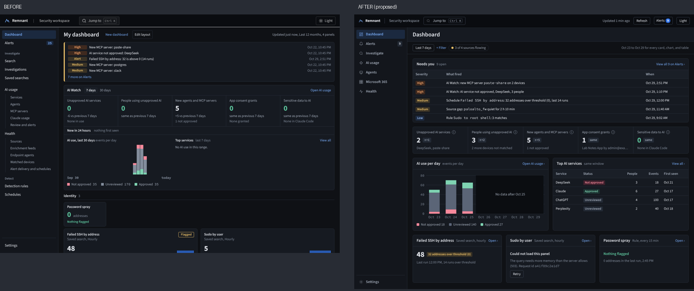 | 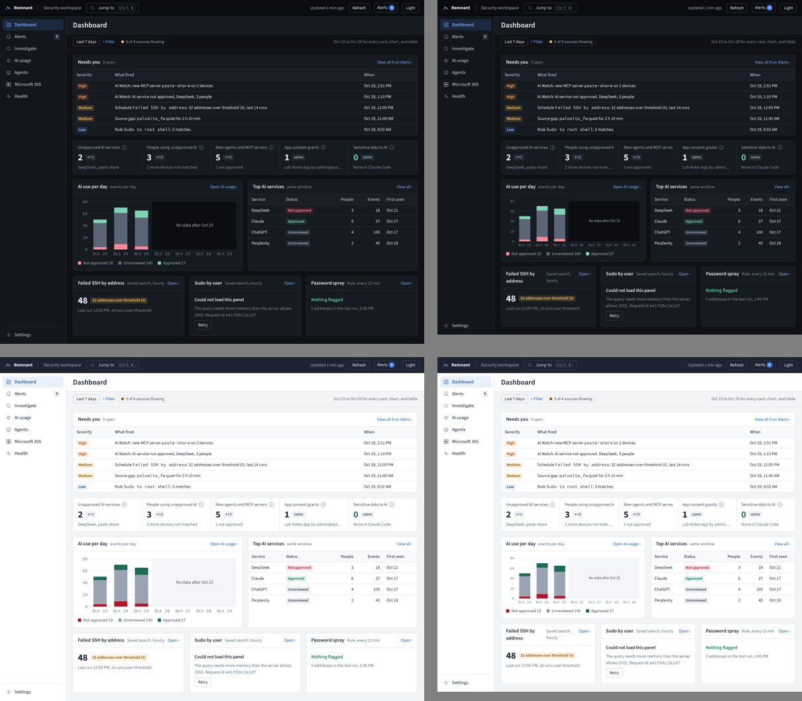 |
| Alerts | 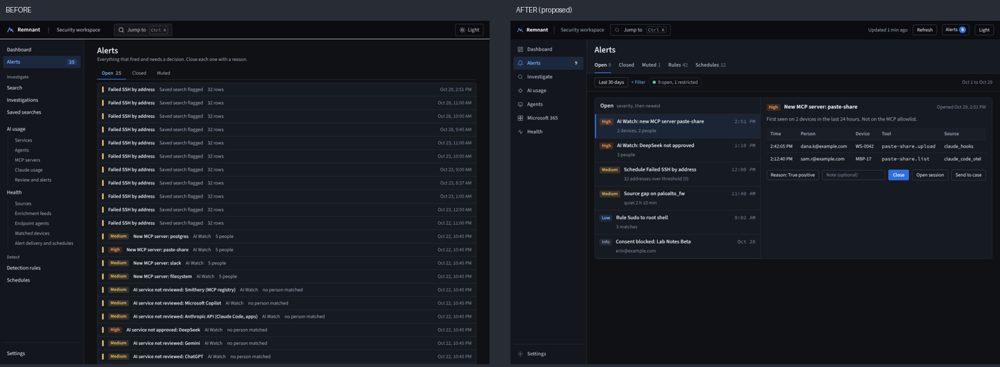 | 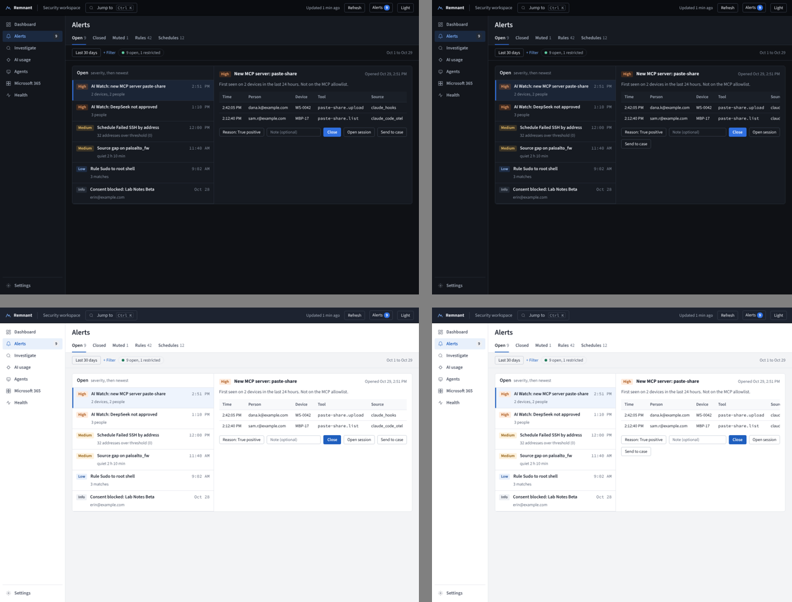 |
| Agents > Sessions | 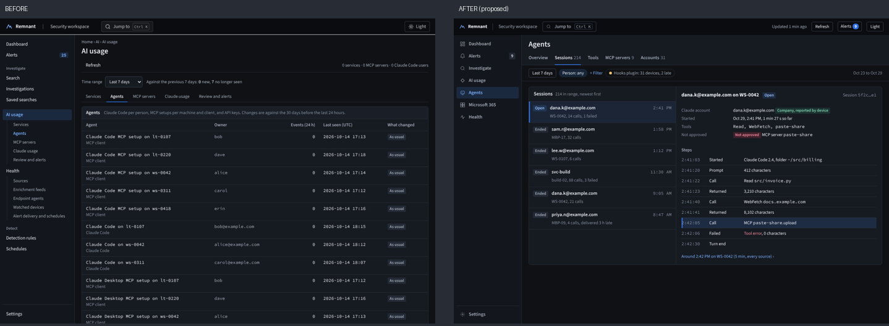 | 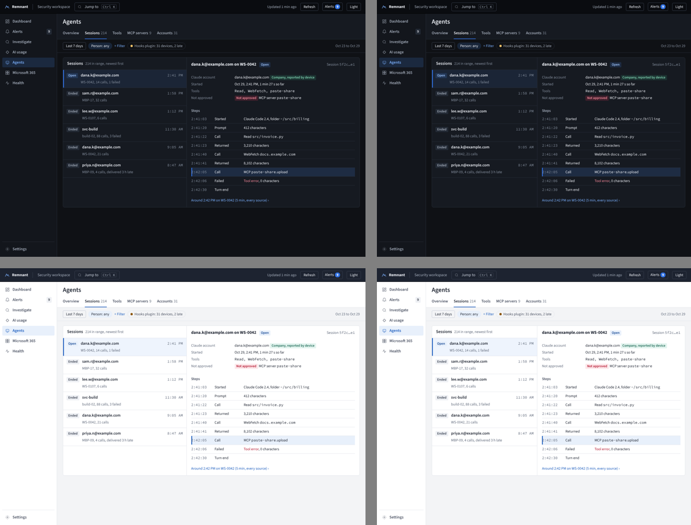 |
| AI usage > Inventory | 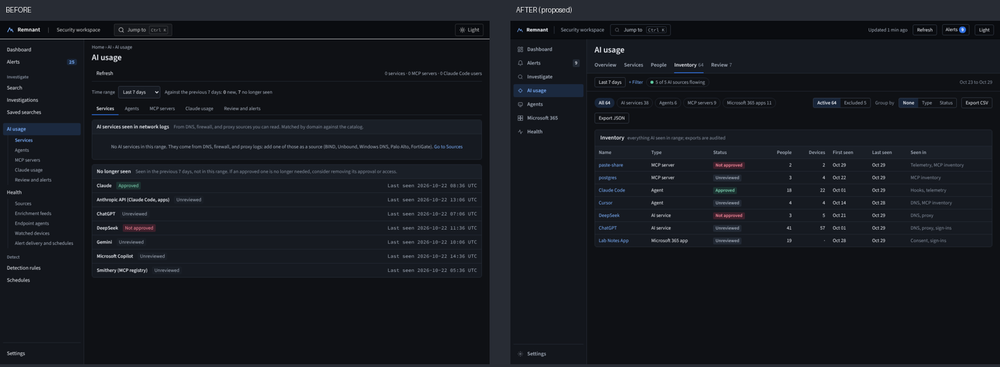 | 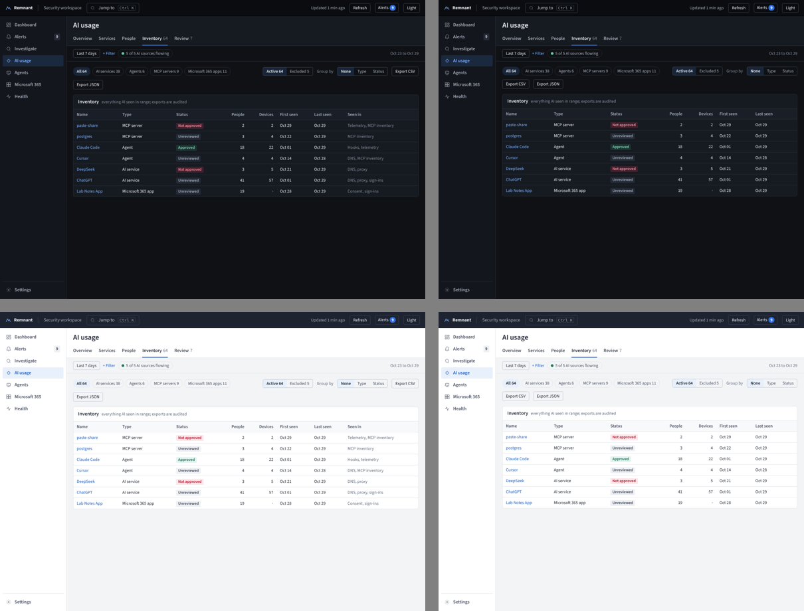 |
| Microsoft 365 > Overview | (new) | 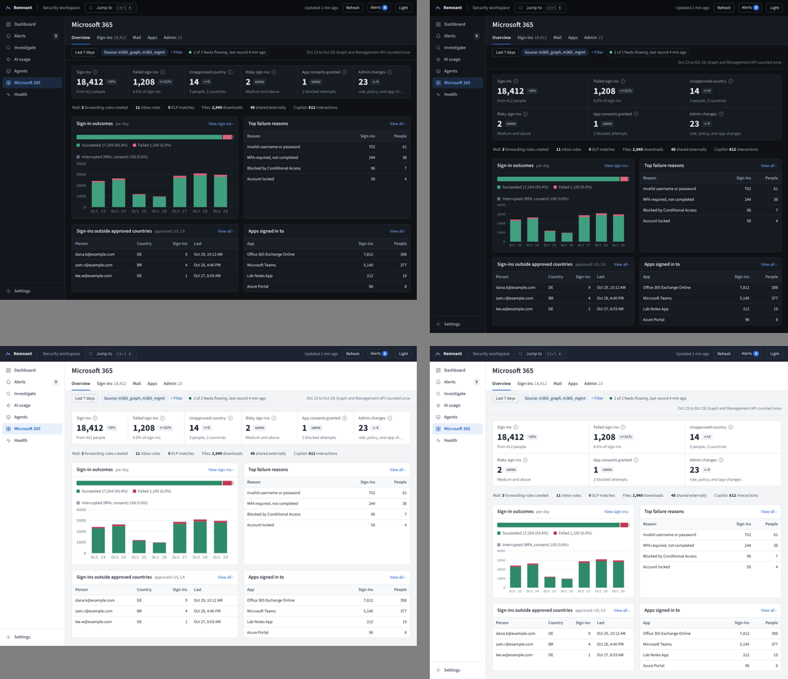 |
| Search, Around this event | (new) | 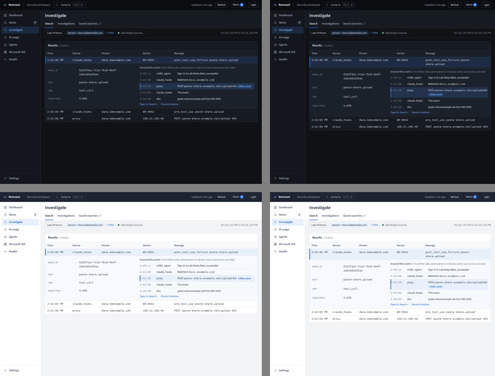 |
| Person timeline | (new) | 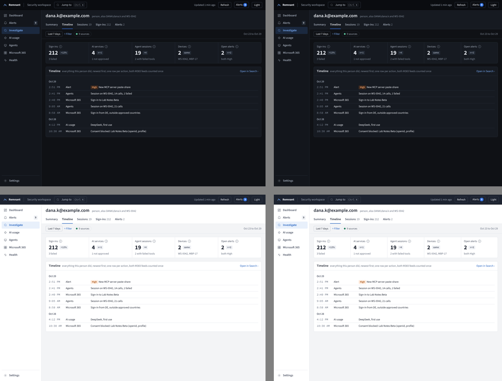 |

## Decision

### 1. Areas and the two-level nav

```
Before (rail, 16 rows + Settings)          After (rail, 7 areas + Settings; tabs in the page header)
---------------------------------          ---------------------------------------------------------
Dashboard                                  Dashboard        (no tabs; the morning answer)
Alerts                 25                  Alerts       9   Open | Closed | Muted | Rules | Schedules
Investigate                                Investigate      Search | People & devices | Saved searches
  Search, Investigations, Saved searches   AI usage         Overview | Services | People | Inventory | Review
AI usage                                   Agents           Overview | Sessions | Tools | MCP servers | Accounts
  Services, Agents, MCP servers,           Microsoft 365    Overview | Sign-ins | Mail | Apps | Admin
  Claude usage, Review and alerts          Health           Overview | Sources | Enrichment feeds | Endpoint agents |
Health                                                        Watched devices | Delivery
  Sources, Enrichment feeds, Endpoint      -----------
  agents, Watched devices, Alert           Settings         (own sub-nav, unchanged: Start here, Data, Access, AI,
  delivery and schedules                                     Alerts, Records)
Detect
  Detection rules, Schedules
Settings
```

| # | Decision | Why |
|---|---|---|
| 1 | The rail lists **areas** only, one row each, with a 16px Lucide icon and a label (labels stay: DESIGN "labeled nav") | Every row is a place; the rail never grows when a page gains a tab |
| 2 | Tabs sit in the **page header** under the title, as a tab row with counts ("Sessions 214") | The tab is where the content is; one click, visible on the page |
| 3 | Real URLs: `/<area>/<tab>`, for example `/m365/sign-ins`, `/agents/sessions/<session id>`, `/ai/inventory`. Old paths and hash tabs (`/ai#agents`, `/health#source=x`, `/rules`) redirect, so alert messages already sent keep working | Back, links in alert messages, and the command palette (`Microsoft 365 › Sign-ins`) all reach a tab |
| 4 | Each data area opens on **Overview** (KPIs and tops), then its lists. Alerts and Investigate open on their list: an overview of a queue is the queue | Asked: "an Overview tab per area"; pushback on two areas, see Questions 1 |
| 5 | **Detect folds into Alerts** (Rules and Schedules tabs): rules and schedules exist to raise alerts | Keeps the rail at 7 areas with M365 and Agents added (asked: about 6) |
| 6 | **Agents** is its own area; AI usage keeps services, people, and inventory | Sessions and tools are a daily list for the pilot; under AI usage they were three tabs deep |
| 7 | Below 1100px the rail collapses to icons with labels on hover and focus; the tab row scrolls sideways | DESIGN 5 already collapses below 1100px |
| 8 | Breadcrumbs go, except on entity pages (`Investigate › dana.k@example.com`) | Area plus tab is the "where am I"; a crumb repeating it costs a row. Amends DESIGN 1 and 8 |

### 2. Top bar

| # | Decision |
|---|---|
| 9 | Right side: **Updated 1 min ago** and **Refresh** (refetches every query on the page; auto-refresh stays per page as today), an **Alerts** button with the open count (opens `/alerts/open`), theme, user |
| 10 | The rail's Alerts row keeps its count; the bell is the same number, for when the rail is collapsed. See Questions 2 |

### 3. Page grammar (every area page)

```
+---------------------------------------------------------------------------------------+
| Title                                                                                 |
| Overview | Sign-ins 18,412 | Mail | Apps | Admin 23                       (tab row)    |
+---------------------------------------------------------------------------------------+
| [Last 7 days] [chips] + Filter  (o 2 of 2 feeds flowing, last record 4 min ago)      |
|                                         Oct 23 to Oct 29 for every card and table    |
+---------------------------------------------------------------------------------------+
| KPI strip: label (i) | value [delta pill] | context line                (5 or 6)      |
| secondary counts: Mail: 3 forwarding rules created   11 inbox rules   0 DLP matches   |
| [Outcome bar + trend per day, axes printed]   [Top N table          View all >]      |
| [Top N table                      View all >] [Top N table          View all >]      |
+---------------------------------------------------------------------------------------+
```

| # | Part | Decision |
|---|---|---|
| 11 | Filter bar | One **time window per page**, applied to every card, chart, and table on it (owner 16:21). Chips for other filters; state in the URL fragment (`#range=7d&person=x`), so a link reopens the same view. Right side states the window in words ("Oct 23 to Oct 29 for every card, chart, and table") |
| 12 | Data-source pill | One pill: "4 of 4 sources flowing" (dot ok) or "3 of 4 sources flowing" (dot warn), with the last record time; opens the Health rows for the page's sources |
| 13 | KPI strip | 5 or 6 tiles, one row (6 become 3 x 2 below 1180px). Label, an (i) that says what is counted and from what ("Graph and Management API counted once"), the value, a **delta pill** against the previous window of the same length, and one context line. Delta pills are neutral (arrow plus number); color never says good or bad, since more sign-ins is neither (DESIGN: severity colors only for severity). A zero is in the ok color, as today |
| 14 | Secondary counts | One text row of smaller counts that do not earn a tile; each number opens its rows |
| 15 | Outcome bar and trend | Parts of a whole as one horizontal bar with printed counts and percents, then a per-day stacked bar chart with a y axis (3 to 5 ticks) and dated x labels. No donuts, no gauges |
| 16 | Top N tables | Top 4 to 10 rows, numbers right-aligned, card header "**View all ›**" opening the list tab with the same filter |
| 17 | Card header | Title, a muted meta ("per day", "approved: US, CA"), and one link on the right ("View all ›", "Open ›"). Every number on a card opens the rows behind it (F66) |
| 18 | Card states | One component, five states: loading (skeleton of the card's shape), empty ("No consents in this range" plus what would fill it), error (what failed, the HTTP status, request id, **Retry**), needs a source ("Needs a Microsoft 365 source", link to add it), restricted ("Restricted": the viewer may not read a source it uses). A sixth modifier, **partial**: "No data after Oct 25" shaded on charts and stated in the card meta when a source stopped before the window ended (owner 16:21) |
| 19 | List-detail | Queues where you work item by item (Alerts, Agents > Sessions) use a list on the left and the item on the right, URL per item. Events in Search still expand in place (DESIGN "detail in place" stays for events) |

### 4. The owner's 16:21 fixes

| Fix | In the after version |
|---|---|
| One time window per page | Filter bar row 11; Dashboard cards, chart, and top services all read "Last 7 days" |
| Data ends before today | Chart shades the days after the last record and says "No data after Oct 25"; the pill says how many sources flow |
| Banner badge column is severity only | Needs you: the first column is High, Medium, Low, Info; the type goes in the text ("Schedule Failed SSH by address: ...") |
| Flag wording | "32 addresses over threshold (0)", never "32 is above 0" |
| Readable chart axes | Every chart has y ticks and dated x labels, or prints its values when there are 7 bars or fewer |

### 5. Microsoft 365 area

| Tab | Content |
|---|---|
| Overview | KPIs: Sign-ins, Failed sign-ins, Sign-ins outside approved countries, Risky sign-ins, App consents granted (blocked in context), Admin changes. Counts row: mail rules, forwarding, DLP, file downloads, external shares, Copilot interactions. Outcome bar (succeeded, failed, interrupted) and per-day trend. Tops: failure reasons, sign-ins outside approved countries, apps signed in to |
| Sign-ins, Mail, Apps, Admin | Event lists in the Search table (same columns registry, expand in place), each with the page filter bar and a default sort; Apps lists consents (granted and blocked) and app registrations |
| Admin setting | **Approved countries** (Settings > Data > Microsoft 365), empty by default: then the KPI reads "Set approved countries" instead of a number |
| Counting | Every M365 count uses the one-operation key (D122): Graph and Management API never count twice |
| Speed | A daily **M365 rollup** like the AI rollup (D116): closed days from the rollup, today from events, so 30 days stays fast |

### 6. Agents area

| Tab | Content |
|---|---|
| Overview | KPIs: sessions, people, tool calls, failed tool calls, not-approved MCP servers in use, devices late or missing (hooks queue, D120) |
| Sessions | List-detail: session list (person, device, start, open or ended, calls, failed, "delivered 3 h late"); the detail shows the Claude account tier (ADR-0030 amendment), tools, not-approved items, and the steps in order with a link to "Around" the selected step |
| Tools, MCP servers | Typed tables: name, status, people, devices, calls, failed, first and last seen |
| Accounts | Claude accounts by tier (company confirmed, company reported, not confirmed, personal, not checked), with devices and people |

### 7. Inventory (AI usage > Inventory)

| # | Decision |
|---|---|
| 20 | One typed table of everything AI seen: AI services, agents, MCP servers, Microsoft 365 apps (consented), with type, status, people, devices, first and last seen, and where it was seen |
| 21 | Sub-tabs by type with counts; **Active** and **Excluded** (excluded items stay listed there with who excluded them and why); Group by none, type, or status |
| 22 | **Export CSV** and **Export JSON** of the current view; each export writes an audit row (`ai.inventory_export`, filters, row count) |

### 8. Around this event (F66 item 4)

| # | Decision |
|---|---|
| 23 | Every expanded event row (Search, Sessions steps, alert rows) has **Around this event**: 5 minutes either side, same person or same device, every source the viewer may read, at most 50 rows, newest last |
| 24 | Person and device come from the event's own columns and the identity spans of ADR-0029 (who had the address then), so a proxy row with only an IP joins the person |
| 25 | **Likely cause**: a deterministic hint, at most one row: the nearest earlier row from another source with a failure, block, or deny status, or a first-seen entity. Labeled "Likely cause", in the accent tint, never a severity color, with the rule that picked it in its tooltip. No model call |
| 26 | "Open in Search" opens the same window as SQL; the query runs through the guard on the caller's `events` view like anything typed |

### 9. Person timeline (F66 item 5)

| # | Decision |
|---|---|
| 27 | The entity page for a person gets tabs: Summary, **Timeline**, Sessions, Sign-ins, Alerts |
| 28 | Timeline: one row per action, newest first, grouped by day, across sources (sign-ins, sessions as one row each, AI first uses, consents, alerts), M365 counted once; each row opens its events; "Open in Search" gives the SQL |
| 29 | The person is resolved across forms (`dana.k@example.com`, `DANA\dana.k`, devices bound to them), stated under the title |

## Design critique (before and after)

| Finding | Before | After |
|---|---|---|
| Wayfinding | 16 rail rows plus group headings; tab pages repeat their tabs in the rail | 7 areas; tabs where the content is |
| Time | Three windows on the Dashboard (7 days, 30 days, top services) | One window per page, stated in words |
| First glance | Needs you badges mix severity and type ("Alert", "High") | Severity column only; type in text |
| Charts | No y axis; empty right two thirds when data stopped | Axes and dated labels; shaded "No data after" |
| States | Each card has its own empty, error, and setup text | One card-state component, five states and partial |
| Risks in the after version | Delta pills could read as good or bad; list-detail could spread to event reading | Pills neutral with arrows; list-detail only for queues (row 19) |

Accessibility: tab row is a `tablist` with arrow-key moves; the rail keeps visible focus; KPI (i) is a button with the text in an accessible tooltip; charts keep their text summary (`aria-label` with every series total); color is never the only signal (badges have labels, deltas have arrows).

## Questions for the owner

| # | Question | Proposal |
|---|---|---|
| 1 | Overview tabs on Alerts and Investigate? | No: Alerts opens on Open, Investigate on Search. An overview of a queue is the queue |
| 2 | Bell and the rail count both show open alerts | Keep both: the bell is for the collapsed rail and narrow screens; same number, same link |
| 3 | 7 areas against "about 6" | Fold Detect into Alerts (done above). If 7 is too many, Agents can be a tab group under AI usage, at the cost of a third level |
| 4 | Settings | Unchanged: its own sub-nav; not part of this change |
| 5 | Breadcrumbs | Removed except on entity pages |

## Consequences

- Nav, URLs, and redirects change in one PR; every page header moves to the new header with tabs (mechanical, one PR). DESIGN.md sections 1, 5, 6, 7, and 8 are amended in the same PR as the nav.
- New shared components: filter bar with source pill, KPI strip, counts row, outcome bar, chart axes, card-state component, list-detail. Existing pages adopt them area by area.
- Microsoft 365 needs the approved-countries setting, the M365 rollup, and the one-operation key everywhere (D122). Agents needs Overview, Tools, MCP servers, and Accounts queries over `claude_hooks` and telemetry.
- Around this event and the person timeline are new read paths: both run on the caller's `events` view with a time-bounded scope (10 minutes; the timeline's page window), so they cost one bounded query each.

Build order after approval (each a PR under 400 lines where possible): (1) nav, URLs, redirects, header with tabs, DESIGN.md; (2) page grammar components on the Dashboard with the 16:21 fixes; (3) Microsoft 365 area with the rollup; (4) Agents area; (5) Inventory; (6) Around this event; (7) person timeline.

## ATLAS / ATT&CK

No new model call: Around this event and Likely cause are deterministic SQL, and nothing here sends events to a provider. Access stays source-based (rule 13): every new view, export, and timeline reads the caller's `events` view, and a card the viewer cannot fully read says Restricted. The inventory export is a list of AI tools and who used them: admin and analyst only, audited per export, so a bulk pull is visible (ATT&CK T1213 Data from Information Repositories, as the abuse case). Likely cause is a hint labeled as one; it never closes or raises an alert.

## Owner edits (2026-10-29, on approval)

| # | Edit | Effect on the decision |
|---|---|---|
| 1 | Approved countries is an admin setting: a list, empty by default | Settings > Data > Microsoft 365 > **Approved countries** (country codes). Empty: the card says "Set approved countries" with a link instead of a number. The KPI label is **Sign-ins outside approved countries**. Each install keeps its own list in its settings; none ships in the repo |
| 2 | Failed sign-ins are not red | Routine failures in outcome bars and trends use the warn tone (failed) and muted (interrupted); red stays for severity. Applies to every outcome bar, not only M365 |
| 3 | AI usage Review and Alerts' AI Watch items are one queue | **Review** is the Alerts list filtered to AI Watch items (same rows, same Close, same counts), shown under AI usage; there is no second list or table |
| 4 | Investigate tab "Investigations" is renamed | **People & devices** (`/investigate/people`); old `/investigations` links redirect |
| 5 | M365 secondary counts | Every count in the row is a link to its rows (Search with the page window), as in row 17 |
| 6 | Truncated card text | Card context lines wrap to two lines, then end with an ellipsis and carry the full text as a tooltip (`title` and an accessible description) |
| 7 | Theme toggle | Sun and moon icon button with a tooltip ("Switch to light theme"), not the word |
| 8 | "No data after X" | A thin hatched band at the right edge of the chart where data stopped, plus a note in the card meta ("No data after Oct 25"); existing bars keep their full width and stay readable. Never a block over the chart |
| 9 | AI Watch stays one block on the Dashboard (owner, 18:34) | The Dashboard keeps the AI Watch section as a unit: its header with the 7 or 30 days toggle and **Open AI usage**, then the cards, New in 24 hours, the chart, and top services. The redesign restyles it (KPI strip, delta pills, card states, chart axes, hatched "No data after") and does not break it up. Its toggle is the block's time window: the cards, the chart, and top services all follow it, so row 11 holds inside the block |

## Owner edits (2026-10-30, shell and Dashboard on a wide monitor)

Feedback from the owner's 2000 px screen, approved with the dark previews at 1920 and 1280.

| # | Edit | Effect on the decision |
|---|---|---|
| 10 | Grouped rail replaces one row per area | The rail is 240 px from 1100 px up (the icon rail stays below that), with larger rows and four collapsible groups: **Monitor** (Dashboard, Alerts, Microsoft 365), **Investigate** (Search, People & devices, Saved searches), **AI** (AI usage, Agents), **System** (Health, Settings). Every page lists its sub-pages under it, the current one highlighted; each group's open or closed state is remembered per browser. Header tabs stay. The top bar puts a wide search in the center that finds pages and entities (an address, user, host, or AI service goes to its entity page); "Updated" appears once, in the top bar; the bell carries the open alert count. The Dashboard has one time window for the page. Amends sections 1 and 2, and DESIGN 3, 5 and 6.3 |

### The eight calls behind edit 10

| # | Call | Owner |
|---|---|---|
| 1 | Settings keeps its own sub-nav on the Settings page; its 12 sub-pages are not listed in the rail, so the rail fits a 1080 px tall screen | Approved |
| 2 | Microsoft 365 sits under **Monitor** | Changed by the owner (proposed under Investigate) |
| 3 | AI Watch follows the page window (24 hours, 7 days, 30 days) and drops its own 7 or 30 days toggle; supersedes the toggle in edit 9, the block otherwise stays one unit. 24 hours compares against the previous 24 hours and charts by hour. Built: the new sections chart by hour; AI Watch's cards compare 24 hours, but its chart keeps 7 days because AI use is rolled up by day | Approved |
| 4 | Identity charts failed sign-ins per day only, in the warn tone, with the failure rate in the chart note; the succeeded and failed bar stays on the Microsoft 365 page | Approved |
| 5 | Per-host and per-rule charts are small multiples (one row of daily bars per host or rule, own scale, peak and total printed), not colored stacks; severity colors stay reserved | Approved |
| 6 | Approved countries (edit 1) ships with the Dashboard sections, ahead of the Microsoft 365 area; until it is set, Identity and VPN cards show **Set approved countries**. It lives on Settings > Enrichment (**Countries and networks**, beside GeoIP, which resolves the countries) with Internal networks, instead of a Microsoft 365 settings page, since VPN logins use it too | Approved |
| 7 | Density (comfortable or compact) is a per-user choice in the user menu; comfortable by default from 1440 px wide, compact below | Approved |
| 8 | "External" means not in the **Internal networks** list. The list takes private and public addresses and ranges (an office egress is public); it defaults to the private ranges (10/8, 172.16/12, 192.168/16, fc00::/7, loopback, link-local) and Settings prompts to add the company's egress addresses | Changed by the owner (public entries and the egress prompt) |

Build order, one PR each: rail and top bar; entity search (scoped to the sources the viewer can read, like every query surface); Dashboard sections with Approved countries and Internal networks.
